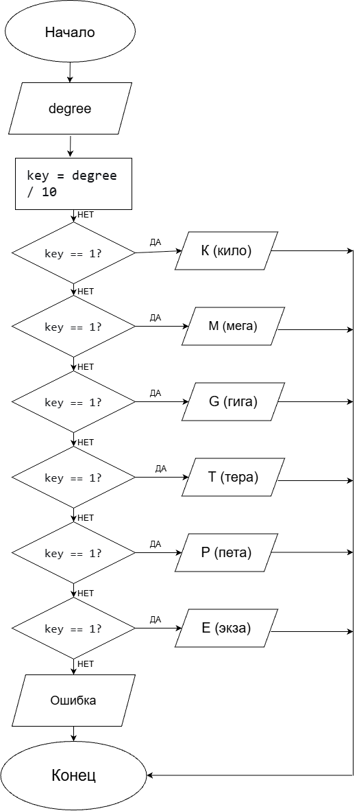
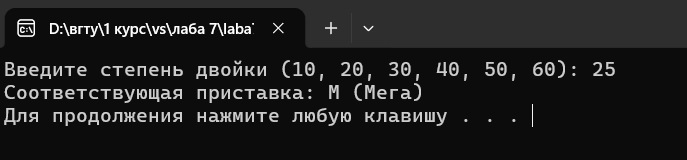

 <h1>Домашнее задание к работе 7 </h1>

## Условие задачи
Напишите программу, которая интерпретирует степени 2 в соответствующие приставки (10-К, 20-М, G, T, P, E). 
## Решение задачи

1. <b>Алгоритм и блок-схема </b>  
<i>Алгоритм</i> 
1) Начало
2) Объявление переменной: int degree;
3) Ввод данных: Запрос у пользователя степени двойки (10, 20, 30, 40, 50, 60) и считывание её в переменную degree.
4) Вычисление ключа: Вычислить значение degree / 10 (целочисленное деление на 10 отбрасывает последнюю цифру, превращая 10 в 1, 20 в 2 и т.д.).
5) Множественный выбор (switch) по результату degree / 10:
- Если результат равен 1: Вывести «K (Кило)» и перейти к шагу 7.
- Если результат равен 2: Вывести «M (Мега)» и перейти к шагу 7.
- Если результат равен 3: Вывести «G (Гига)» и перейти к шагу 7.
- Если результат равен 4: Вывести «T (Тера)» и перейти к шагу 7.
- Если результат равен 5: Вывести «P (Пета)» и перейти к шагу 7.
- Если результат равен 6: Вывести «E (Экза)» и перейти к шагу 7.
- Иначе (для всех остальных чисел): Вывести «Ошибка...» и перейти к шагу 7.
6) Конец 
<i>Блок-схема </i> 

2. <b>Реализация программы</b> 
#define _CRT_SECURE_NO_WARNINGS  
#include <stdio.h> 
#include <locale.h> 
#include <math.h> 
int main() { 
    setlocale(LC_ALL, ".UTF8"); 
    int degree; 
    printf("Введите степень двойки (10, 20, 30, 40, 50, 60): "); 
    scanf("%d", &degree); 
    switch (degree / 10) { 
    case 1: 
        printf("Соответствующая приставка: K (Кило)\n"); 
        break; 
    case 2: 
        printf("Соответствующая приставка: M (Мега) \n"); 
        break; 
    case 3: 
        printf("Соответствующая приставка: G (Гига) \n"); 
        break; 
    case 4: 
        printf("Соответствующая приставка: T (Тера) \n"); 
        break; 
    case 5: 
        printf("Соответствующая приставка: P (Пета) \n"); 
        break; 
    case 6: 
        printf("Соответствующая приставка: E (Экза) \n"); 
        break; 
    default: 
        printf("Ошибка: для данного диапазона степеней приставка не задана\n"); 
        break; 
    } 
    return 0; 
} 
3. <b>Результат работы программы</b> 
 

4. <b>Информация о разработчике</b> 
Выполнила работу: Кучеренко Дарья, гр.бИЦТ-261, вариант 18